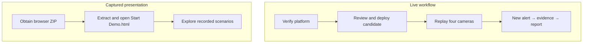

# Warehouse video intelligence demo

Deploy the NVIDIA VSS 3.2.1 Warehouse candidate on an existing OpenShift
platform, replay four camera sources through that deployment, or present the
captured browser demo. These are three separate workflows.



## Choose a workflow

| Workflow | Start here | Result |
| --- | --- | --- |
| New deployment | [Deployment guide](deployment/DEPLOYMENT.md) | Site-specific, reviewed installation plan and acceptance procedure. |
| Live camera replay | [Start and stop](#start-and-stop-a-live-replay) | New RTSP playback, recordings and inference in an installed environment. |
| Captured browser ZIP | [Browser demonstration](clickthrough/README.md) | Recorded screens, evidence, reports and answers; no live inference. |

The deployment and portable session controller are review candidates:
fresh-install, cold-restart and bounded-hour acceptance remain pending.
The captured presentation and retained Search results do not establish those
Warehouse results. See [validation scope](VALIDATION.md).

## Prerequisites

| Path | Required inputs |
| --- | --- |
| Deploy or live replay | Existing OpenShift cluster, healthy GPU Operator/driver, five available exclusive GPUs, VAST CSI RWO/RWX storage, DNS, synchronized UTC clocks and trusted TLS. |
| Deployment client | `oc`, Python 3.10+, authorized registry/model access, pinned images, site configuration and separately provisioned credential references. |
| Source preparation | FFmpeg/FFprobe, four authorized 600-second Warehouse MP4s and RT-DETR ONNX model; use verified 3600-second copies for an hour source. |
| Captured presentation | Complete reviewed browser ZIP and a desktop browser with JavaScript/MP4 playback; no cluster, Python or server. |

## Start and stop a live replay

First complete [deployment and asset population](deployment/DEPLOYMENT.md).
From the repository root, review the plan, then execute only after approval:

```bash
cd warehouse-vss-demo/deployment
python3 warehouse_session.py --plan-directory reviewed-install --record-seconds 120
python3 warehouse_session.py --plan-directory reviewed-install \
  --media-manifest reviewed-install/media-manifest.json \
  --camera-map-output run-01-cameras.json --record-seconds 120 --execute
```

Keep this terminal open. Wait for `RECORDING_READY` and verify fresh CV/Kafka
processing before the UI demo. Stop early with **Ctrl+C in the same terminal**,
or let the bounded session finish. Require four recorders OFF, source replicas
zero and source Pods absent; recordings, cameras and rules are retained.
After short acceptance, omit `--record-seconds` for the reviewed source window.
Run one session controller only. The native API has no atomic session lease;
do not use another controller or start/stop control concurrently.

## Demonstrate two English alerts

1. In **Alerts → Manage Alerts → Create alert rule**, select **Camera_01**,
   name the rule **Hard Hat Missing**, and ask: “Is a person standing or
   walking in the aisle clearly visible without a hard hat? Answer only Yes
   or No. Do not infer a missing hard hat when the person's head is obscured.”
2. Select **Camera**, name the rule **Forklift and Person Alert**, and ask:
   “Is a person visibly walking close to a forklift in the same warehouse
   aisle? Answer only Yes or No. Summarize in one line what was happening.”

For each, use **View Alerts → VLM Verified → Confirmed → Refresh** with the
matching camera/rule and current UTC range. Require a new alert, visually
matching playable evidence, and **Generate Report** with both report artifacts.
Ask “What color clothes is the person wearing?” and “What is the person doing?”
Answers must stay bound to that incident and clip. Compare a processed negative
example too; a model's Confirmed label alone is not a safety finding.

## Source and maintenance

[Deployment sources and image recipes](deployment/build/README.md) retain
pinned NVIDIA inputs and shipped corrections; see [image preservation](images/README.md).
This folder is self-contained; large videos, model weights and credentials
are obtained separately. No existing Search or CVD deployment is replaced.

From the repository root, run the local integrity, link and syntax checks:

```bash
python3 -B warehouse-vss-demo/verify.py
python3 -B warehouse-vss-demo/verify.py --tests
```

`--tests` also runs Python, JavaScript and C++ regressions; it needs Node.js
and a C++17 compiler. Neither command contacts a cluster.

Follow the [credential and merge checks](SECURITY.md) before pushing or merging
changes. Review all security checks on the current PR head, not only Actions.
