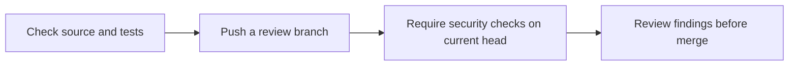

# Credential and merge checks



## Before pushing

From the repository root:

```bash
python3 -B warehouse-vss-demo/verify.py --tests
```

The verifier checks the complete publishable file inventory, hashes, links,
syntax, recognized credential patterns and offline regressions. It rejects
literal credential-like environment values, shell assignments and SQL
password clauses while allowing runtime Secret references. Errors suppress
matched values. These checks supplement, not replace, the independent
GitGuardian scan.

Passwords, registry tokens and database credentials must be supplied through
separately provisioned Secrets. Never add credential files or literal values
to source, captured resources, test fixtures, logs or review comments. Test
cases construct synthetic values at runtime.

## Before merging

With GitHub CLI authenticated, run this read-only preflight for the open PR:

```bash
python3 warehouse-vss-demo/security/check_pr_checks.py \
  --repository ucs-compute-solutions/AI-Data-Platform-CVD --pr PR_NUMBER
```

It checks all pages of check runs and legacy commit statuses for the exact
current PR head, verifies the expected check providers and rereads that head.
Missing, pending, failed or skipped checks block the preflight. Passing checks
on an earlier commit do not count. Merge only that checked head through the
pull request; do not use an administrator override. Server-side branch
protection is the enforcement mechanism, not this last-observed preflight.
An administrator must configure required checks separately; these tools do
not change repository permissions or branch-protection settings.

## When a scanner reports a finding

Review the exact matched code in the scanner dashboard without copying its
value. If an actual credential was published, revoke/rotate it and assess its
use before considering coordinated history cleanup. If the match is a runtime
reference rather than a credential, record that evidence against the specific
incident. Do not broadly ignore files, suppress whole detectors or disguise
code to avoid scanning. A successful scan on a new PR does not resolve an
older incident automatically.
