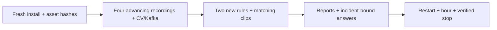

# Validation scope

| Deliverable | Confirmed evidence | Remaining acceptance |
| --- | --- | --- |
| Captured browser demo | Retained source/media checksums and automated package/HTTP tests passed. The presenter confirmed direct-file home page, movie and Hard Hat Missing evidence/PDF/questions. | Direct-file Forklift and Person journey and architecture checks on the intended Mac and Windows browsers; the presenter's browser/OS was not recorded. |
| Historical live Warehouse | The retained installation produced the two captured alert/evidence/report journeys and completed bounded recording sessions. | These site-specific results do not validate the new installer or portable controller. |
| Image preservation | All 25 required pins, resolving to 24 Linux/amd64 images, were downloaded to client-local storage and passed independent manifest/config/layer verification without cluster access. Seven custom images also passed full content verification in two archives on a separate workstation. | Move the full mirror to retained external storage before removing the client VM. Customer registry distribution is a separate action; see [image handoff](images/README.md). |
| This deployment/session candidate | Captured nonsecret baseline, pinned images/build inputs, offline rendering and synthetic contract tests are included. | Clean-site installation, full runtime-image rebuilds, fresh initialization, both new UI journeys, discovered-ID cold/warm restarts and bounded-hour cleanup. Offline logic corrections are not a new-site or full-hour pass. |

The retained Search upload/indexing/Search/Agent/Critic pass belongs to the
separate NVIDIA Search profile. Its fixed upload epoch is not used for
Warehouse RTSP: Warehouse evidence and reports must use the session's real
UTC interval.

The prebuilt-image restore path does not require rebuilding images. Rebuilding
all runtime images from source remains untested; fresh-site and lifecycle
acceptance have not been performed for this portable candidate.

## Ingestion regression coverage

- Stable Service DNS follows the target namespace and cluster domain; stale
  retained addresses are rejected before recording, not silently rewritten.
- Exact, nonempty camera IDs, registration retries and four concurrent starts
  are checked without deleting retained cameras, rules or recordings.
- Fresh UTC timelines must keep advancing for every camera; backward or
  stalled media revokes readiness. Old clips cannot establish a new run.
- Late startup, partial START, lost scale responses and stop failures use
  bounded cleanup and require OFF states plus source-Pod absence. Active
  unrelated recording is not adopted. Run one lifecycle controller at a time.

These are synthetic regression checks, not live acceptance of the portable
controller. In particular, unknown cold recorder state and upstream stream
disconnection/synchronization behavior still require native runtime testing.

## Record a new live acceptance

Record the source revision, reviewed plan hash, image digests, platform/model
versions, UTC run interval, discovered camera IDs and media hashes. Require:

1. Empty-volume initialization, native model/data/configuration checks and
   four advancing recording timelines plus fresh four-camera CV/Kafka proof.
2. New positive and processed negative examples for both English rules;
   matching playback, incident/camera/UTC-bound PDF/Markdown, and same-clip
   follow-up answers.
3. A repeated short cycle after source replacement and VIOS cold restart,
   retaining camera IDs and stable DNS without address edits.
4. A bounded-hour run with near-end playback and verified four OFF recorder
   states, source replicas zero/Pods absent, retained PVCs and no unexpected
   restarts. Repeat from a clean source checkout.

Keep sanitized receipts with the test record. Do not include credential
values, Secret contents or kubeconfig in evidence. An admission dry-run,
`RECORDING_READY`, model classification or create receipt proves only its
specific check, not the whole acceptance sequence.
