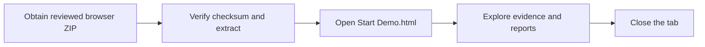

# Captured Warehouse browser demonstration



The captured demo presents **Hard Hat Missing / Camera_01** and **Forklift
and Person Alert / Camera** using recorded screens, incident clips, original
reports and captured follow-up answers. It does not start cameras, contact a
cluster or run inference. The source checkout does not include the large
capture assets; their hashes are in [release-artifacts.json](../release-artifacts.json).

## Present the browser ZIP

1. Obtain `Cisco-AI-POD-Warehouse-Demo-Browser.zip` and verify it against the
   recorded SHA256 before use.
2. Extract the complete ZIP, keeping its folder together. Open **Start
   Demo.html** in a desktop browser; do not open it inside the archive.
3. Choose either scenario and follow the highlighted controls. Play the
   matching evidence, read all report pages and step through the questions.
   **Watch the demo** plays the movie; the architecture view has Automatic
   and sixteen-stage Click-through modes.
4. Close the tab when finished. No Python, executable, app, plugin or local
   server is required.

Pass: both complete scenarios, evidence seeking, all PDF pages, Markdown,
sequential questions, movie and architecture controls work after extraction.
Check the intended Mac and Windows browsers directly through `file:`;
checksums and HTTP testing alone do not establish direct-file compatibility.
See [recorded validation scope](../VALIDATION.md).

## Maintain or rebuild

Use the [browser-only builder](browser-only/README.md) with a complete verified
capture package. It copies referenced media byte-for-byte and creates the
recipient ZIP without re-encoding videos. Build output uses a new directory.
From this directory:

```bash
node --test tests/test-*.cjs
python3 -B -m unittest discover -s browser-only -p 'test_build_browser.py'
python3 browser-only/build_browser.py --source captured-demo --output browser-release
```

The separate HTTP preview uses `tools/serve_demo.py`; it is not needed to open
the browser-only ZIP and does not provide a live Warehouse deployment.
