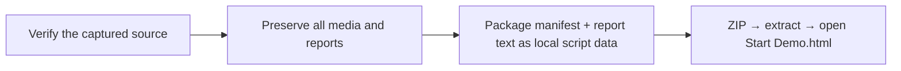

# Browser-only demo package



This variant opens directly in a desktop browser. Recipients do not install
Python, start a server or run an executable/app. The existing localhost preview
and previous packages remain separate and unchanged.

## Build

The maintainer needs Python 3.9+ and the complete source capture accepted by
`tools/verify_bundle.py`. The shared `app.js` must include the reviewed
`WarehouseOfflineCapture` loader. No recipient Python runtime is packaged.

From this directory:

```bash
python3 build_browser.py --source captured-demo --output browser-release
python3 -m unittest discover -s . -p 'test_build_browser.py'
```

Use the actual source directory and a new output parent; an existing output
is never overwritten. The builder verifies every source checksum, validates
the manifest, copies every referenced asset byte-for-byte and retains the
source `demo.json` for provenance. It takes only the adapted `app.js` from
the shared application; `core.js` and `style.css` must match the source.

The generated classic `offline-data.js` contains
`window.WarehouseOfflineCapture = {format: 1, manifest, reports}`. Markdown
report text is preserved, including line endings. Less-than, greater-than,
ampersand and Unicode line-separator characters are JSON escaped; the payload
is never inserted as inline HTML. It loads immediately before `app.js`.
The new offline HTML permits local `file:` scripts, styles, images, media and
report frames, while setting `connect-src 'none'`. It permits neither inline
scripts nor dynamic code evaluation. The original HTTP package and its policy
are unchanged. Manifest and Markdown data are packaged instead of fetched
because browsers can reject file-origin fetch requests; see
[MDN: CORS request not HTTP](https://developer.mozilla.org/en-US/docs/Web/HTTP/Guides/CORS/Errors/CORSRequestNotHttp).

## Output

```text
browser-release/
├── Cisco-AI-POD-Warehouse-Demo-Browser/
│   ├── Start Demo.html
│   ├── index.html
│   ├── offline-data.js
│   ├── app.js · core.js · style.css · demo.json
│   ├── assets/…
│   ├── README.txt
│   ├── BUILD-REPORT.json
│   └── SHA256SUMS.txt
├── Cisco-AI-POD-Warehouse-Demo-Browser.zip
├── build-report.json
└── SHA256SUMS.txt
```

All original MP4s, report PDFs, full-page report images, scenario captures and
architecture stages remain included. The presentation movie is not cropped
or re-encoded. Build reports contain source and payload hashes, not workstation
paths. The recipient package contains no Python, executable, app bundle,
shell launcher, server or plugin.

## Recipient steps

1. Extract the complete ZIP; keep its folder together.
2. Double-click **Start Demo.html**, or choose it using the browser's
   **Open File** command.
3. Follow the highlighted controls in either scenario. Watch the movie,
   play the evidence, read all report pages and explore the captured answers.
4. Close the tab when finished; no background server needs stopping.

Use a current desktop browser with JavaScript and MP4 playback enabled.
The demo works offline; optional vendor references and historical report
links are external. It replays captured results, not live inference.

Before release, test the extracted folder directly through `file:` on the
target Mac and Windows browsers: both complete scenarios, evidence seeking,
all PDF pages/downloads, Markdown, captured questions, movie playback,
sixteen architecture stages, the brand home link and deep-link reload.
Source checksum acceptance alone does not establish browser compatibility.
