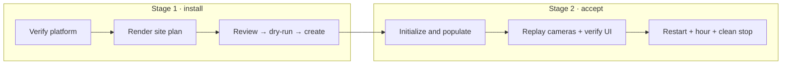
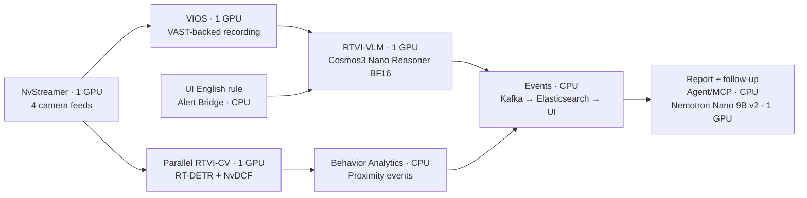
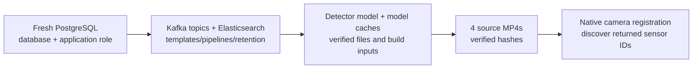

# Deploy NVIDIA VSS 3.2.1 Warehouse



The captured baseline is a new-site installation candidate. Fresh-install,
portable cold-restart and bounded-hour acceptance remain pending; the captured
browser demo is separate. See [validation scope](../VALIDATION.md).
Run the commands below from `warehouse-vss-demo/deployment`.

## 1. Start with the shared platform

Use an existing Red Hat OpenShift cluster, Cisco UCS C845A GPU workers,
and VAST storage with the VAST CSI driver. Full OpenShift, server and VAST
cluster installation is outside this workload guide.

| Foundation | Captured reference | Required before this workload |
| --- | --- | --- |
| OpenShift | 4.20.18 | Working administration access, supported APIs and healthy operators. Record the exact chosen release. |
| Accelerated compute | C845A; 8 RTX PRO 6000 Blackwell Server Edition GPUs, nominal 96 GB each | GPU Operator/driver healthy; five exclusive GPU reservations available for Warehouse. Validate model compatibility on the chosen driver. |
| Host capacity | GPU worker reports 256 logical CPUs and approximately 755 GiB RAM | Review rendered CPU/memory requests and available headroom. These observed values are not minimum sizing. |
| GPU software | Driver 595.91.07; advertised CUDA runtime 13.2 | Record and test the selected driver/runtime; do not treat these observations as certification of other versions. |
| VAST storage | CSI-backed RWO/RWX volumes | StorageClasses plus successful mount, read/write, remount and cross-Pod tests at the application's effective UIDs. Bound status alone is insufficient. |
| Platform services | DNS, synchronized clocks, Routes and trusted TLS | Service/public DNS resolves; timestamps agree; router and application NetworkPolicies permit required flows. |
| Artifacts/client | NGC/model entitlement, registry access, administration client | Digest-pinned images, model/data access, `oc`, Python 3.10+ and trusted registry certificates; FFmpeg/FFprobe for media preparation. |

Before any cluster change, verify the target against `site.json`:

```bash
oc whoami
oc whoami --show-server
oc config current-context
oc get clusteroperators
oc get nodes
oc get storageclass
```

Pass: expected identity/API/context, healthy operators, sufficient approved GPU
capacity and the chosen StorageClasses. Node scheduling changes and credential
provisioning are separately approved platform actions, not installer effects.

## 2. Understand the deployed flow



The five GPU reservations are shared by four cameras, not five per camera.
The selected English-rule path has no embedding or reranking stage. It is
different from the CVD's NVIDIA VSS Search pipeline.

The starting point is NVIDIA's
[VSS v3.2.1 source](https://github.com/NVIDIA-AI-Blueprints/video-search-and-summarization/tree/v3.2.1).
The source intentionally mixes some 3.2.0/3.2.1 service image versions.
Preserve their immutable digests; do not substitute `latest`.

| Custom integration | Why it is included |
| --- | --- |
| OpenShift manifests/SCC/UID/writable paths, service discovery and NetworkPolicies | Translate the Compose deployment's runtime assumptions without changing the models into CPU implementations. |
| Derived NvStreamer build | Late readers, distinct-file quorum and replay accounting; based on a later pinned development commit, not the v3.2.1 VIOS tree. Frame-level synchronization is a separate acceptance claim. |
| Stable VIOS shared listener | Live RTSP 30554 and VOD 30555 advertise Service DNS rather than replaceable Pod IPs. |
| UI patches | Preserve native sensor IDs and isolate each generated report conversation. |
| Agent/MCP patches | Find VLM-only incidents, bind report metadata and keep follow-up questions on the same incident/clip. |
| Fresh PostgreSQL bootstrap | Initialize new empty storage; never run retained-data migration against a new empty volume. |

## 3. Prepare the site and artifacts

1. Copy `baseline/site.render-example.json` to `site.json`. Fill the cluster identity,
   namespace, all Route hostnames, StorageClasses, node selectors, network
   token maps and existing Secret-name references. Keep credential values out
   of this file. Complete the inventory's network-token usages with the
   platform team; do not reuse another cluster's router/API CIDRs.
2. Create the new project and provision the referenced registry, NGC/model,
   PostgreSQL and Agent credentials using the site's normal credential process.
   The installer reads Secret names only. Preserve TLS verification.
3. Obtain upstream images through authorized registries. Build/import the
   custom runtime images and required initialization helpers.
   To restore the preserved prebuilt set without rebuilding, follow the
   [image handoff](../images/README.md).
   Use the sources/locked recipes under `build/` and the shipped source patches.
   Map `registry.example.com` repositories to the actual registry in
   `images.repositoryMirrors`, retaining each copied digest. For rebuilt images,
   record full source-pin → reviewed target-pin mappings in
   `images.reviewedImageOverrides` before rendering; never substitute a tag.
4. Review every Route, network token and image-mirror key in the full example;
   replace all documentation-only values before rendering.

Credential references in the full example use this contract (values are never
part of `site.json`):

| Target Secret | Required type/key |
| --- | --- |
| `ngc-pull` | Image-pull Secret, `kubernetes.io/dockerconfigjson`. |
| `ngc-api` | `NGC_CLI_API_KEY` for the entitled NVIDIA registry/model account. |
| `agent-api` | `api-key` for the configured model endpoint. |
| `vios-postgres-admin` | `admin-password`. |
| `vios-postgres-vst` | `vst-password`; application credential distinct from the admin credential. |

| Site token | Discover in the target cluster; do not copy example values |
| --- | --- |
| `NET_CIDR_1`, `NET_CIDR_2` | Router/OVN-SNAT source addresses seen by application ingress, each `/32`. |
| `NET_CIDR_3` | Kubernetes Service ClusterIP `/32` used for HTTPS TCP 443. |
| `NET_CIDR_4`–`NET_CIDR_6` | Control-plane API endpoint addresses, each `/32`, HTTPS TCP 6443. |

From this directory:

```bash
cp baseline/site.render-example.json site.json
# Complete and review site.json before continuing.

# Offline inventory; no cluster access.
python3 warehouse_deploy.py inventory \
  --baseline baseline/baseline.captured.json

# This renders the source-reviewed candidate, not an accepted install claim.
python3 warehouse_deploy.py render --baseline baseline/baseline.captured.json \
  --site site.json --output reviewed-install

# Review all object names, namespaces, image pins, selectors and storage first.
python3 warehouse_deploy.py dry-run --plan-directory reviewed-install

# After explicit approval: creation is bound to the reviewed plan hash.
python3 warehouse_deploy.py apply --plan-directory reviewed-install \
  --execute --approved-plan-sha256 REVIEWED_PLAN_SHA256
```

**Pass:** identity/API/context match; no existing controllers/PVCs/Jobs are
adopted; required credential references and StorageClasses exist; server
admission passes. A create receipt is not functional deployment acceptance.
The tool never deletes storage or automatically rolls back a partial create.

## 4. Initialize the new data plane



- The fresh PostgreSQL script refuses foreign nonempty data and uses separate
  admin/application Secret references. The existing retained-data migration
  script is not the new-install entry point.
- Creation starts only PostgreSQL, Kafka, Redis, Elasticsearch and Kibana.
  Application/GPU controllers stay at zero replicas while native initialization
  Jobs and model/media population run. The Configurator then imports its
  calibration datasets during application activation; verify those datasets.
- Obtain the NVIDIA Warehouse dataset `vss-warehouse-app-data:3.2.0`. Keep
  the four original **600-second** files and their checksum manifest.
- For a one-hour session, prepare four new **3600-second** files by stream-copy
  repeating each original six times. Runtime looping remains disabled.
  Use `media/prepare-warehouse-hour-videos.py`;
  validate duration, packet continuity and repeat joins, then populate the
  source PVC at the configured read-only subpath. Model/video population is
  separate from the camera-registration API.
- Keep NvStreamer at zero replicas until model/data checks complete. Confirm
  native VIOS readiness, stable Service DNS, PostgreSQL authentication,
  model health and the supported four-camera runtime configuration.

```bash
python3 media/prepare-warehouse-hour-videos.py --input-dir originals \
  --output-dir hour --execute
python3 warehouse_deploy.py initialize --plan-directory reviewed-install \
  --execute --approved-plan-sha256 REVIEWED_PLAN_SHA256
python3 populate_assets.py --plan-directory reviewed-install \
  --model models/rtdetr_warehouse_v1.0.2.fp16.onnx --media-dir hour \
  --hour-manifest hour/manifest.json --execute \
  --approved-plan-sha256 REVIEWED_PLAN_SHA256
python3 warehouse_deploy.py activate --plan-directory reviewed-install \
  --execute --approved-plan-sha256 REVIEWED_PLAN_SHA256
```

Obtain detector resource `nvidia/tao/rtdetr_2d_warehouse:deployable_rn50_v1.0.2`
through authorized NGC access. The populator checks its ONNX hash, verifies
all media, copies without overwriting mismatches and checks hashes inside
the PVCs. Activation requires its successful receipt and helper-Pod cleanup.

## 5. Start a bounded camera session

The portable controller discovers camera IDs; it does not reuse identifiers
from the captured installation. It creates only missing native registrations,
retains existing IDs and uses NVIDIA's sensor/proxy/recorder APIs. It never
deletes a camera to make a test pass.

Run one session controller and no concurrent UI/API start/stop controls. The
native recording API has no atomic session lease. If inactivity cannot be
proved, inspect the source and recorders before approving recovery; do not
interpret refusal to send START or STOP as a verified source shutdown.

```bash
# Offline plan; site/image/media settings come from the reviewed install.
python3 warehouse_session.py --plan-directory reviewed-install

# Execute a fresh finite session. Keep this foreground terminal open.
python3 warehouse_session.py --plan-directory reviewed-install \
  --media-manifest reviewed-install/media-manifest.json \
  --camera-map-output run-01-cameras.json --record-seconds 120 --execute
```

After the short acceptance cycle passes, omit `--record-seconds` for the
bounded source window selected in `site.media`. The recording-stop deadline
is source duration minus 200 seconds after the scale request: +400 seconds
for 600-second media or +3400 seconds for 3600-second media. The remaining
budget covers recorder STOP, source absence checks and an end-of-file margin;
it is not measured from detected PLAY or certified live wall-clock timing.
Use a new `--camera-map-output` filename for each run. The controller owns its local
API forwards and source start. `--replay-saved-rules` explicitly reconnects
existing saved rules; it does not create demonstration rules.

**Pass:** four discovered native IDs; stable proxy hosts; four USER recorder
states and advancing timelines. `RECORDING_READY` means the recording checks
passed; UI alerts, CV processing and report quality remain separate checks.

Existing cameras with stale source addresses are rejected, not migrated or
deleted. A cold VIOS inventory with unknown/absent recorder state cannot be
treated as proven inactive; inspect it and review recovery separately.
Do not edit Pod IPs or remove retained cameras to bypass a failed check.

## 6. Verify the end-to-end experience in the UI

Open the configured public hostname. Create these rules manually in
**Alerts → Manage Alerts → Create alert rule**:

| Camera / rule | Prompt |
| --- | --- |
| Camera_01 / Hard Hat Missing | Is a person standing or walking in the aisle clearly visible without a hard hat? Answer only Yes or No. Do not infer a missing hard hat when the person's head is obscured. |
| Camera / Forklift and Person Alert | Is a person visibly walking close to a forklift in the same warehouse aisle? Answer only Yes or No. Summarize in one line what was happening. |

Under **View Alerts**, enable **VLM Verified**, choose **Confirmed**, the
camera and rule, set a suitable query range, then select **Refresh**.
Require a **new** event after the rule was saved—not a retained historical row.
Use real session UTC timestamps; the separate Search upload epoch convention
does not apply to this RTSP workflow.

For each rule:

1. Play its matching evidence and visually compare it with the prompt.
2. Select **Generate Report** on that incident; open both report artifacts.
3. Check incident ID, camera and UTC interval; inspect all report pages.
4. Ask “What color clothes is the person wearing?” then “What is the person
   doing?” Confirm the answer stays on the selected incident/clip.
5. Try a negative example whose processed video clearly lacks the requested
   activity. An empty alert list alone does not prove evaluation occurred.

Raw **Proximity Violation** is the separate CV/Behavior Analytics path;
view it with VLM Verified off. A VLM Confirmed label does not independently
prove motion, safety risk or object counts—compare the actual evidence.

## 7. Stop, restart and accept the installation

Let the bounded session finish, or press **Ctrl+C in its original terminal**.
Require verified four OFF states, source replicas zero and source Pods absent; retain
the camera map, recordings, rules and completion output. Do not force-kill
the controller or treat a closed terminal as a proven clean stop.

Repeat a short full UI cycle after replacing the source Pod, then after a
VIOS cold restart. Retained rules must use stable DNS and the same camera
IDs without address edits. Next run the bounded hour and verify matching
playback near its end. Record final source absence, inactive recording intent,
model/CV health, retained PVC bindings and no unexpected restarts.

Record the acceptance evidence in [VALIDATION.md](../VALIDATION.md)'s test
sequence, including a repeat from a clean source checkout. Preserve all PVCs
and retained data on failure; inspect partial creation or runtime cleanup
before approving recovery. There is no automatic data-deleting rollback.
