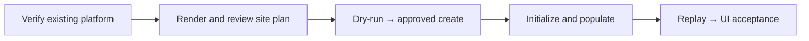

# Warehouse deployment candidate



Follow [DEPLOYMENT.md](DEPLOYMENT.md) for the complete procedure. This is the
NVIDIA VSS 3.2.1 Warehouse workload, not the separate Search profile.
The captured baseline and portable controller have not passed fresh-install,
cold-restart or bounded-hour acceptance; see [validation scope](../VALIDATION.md).

From this directory:

```bash
# Offline: report source inputs and remaining acceptance requirements.
python3 warehouse_deploy.py inventory --baseline baseline/baseline.captured.json

# Offline: use a completed site.json; create a new local plan directory.
python3 warehouse_deploy.py render --baseline baseline/baseline.captured.json \
  --site site.json --output reviewed-install

# Read identity/resources and submit non-persistent server admission checks.
python3 warehouse_deploy.py dry-run --plan-directory reviewed-install

# After explicit approval: create only the hash-bound reviewed resources.
python3 warehouse_deploy.py apply --plan-directory reviewed-install \
  --execute --approved-plan-sha256 REVIEWED_PLAN_SHA256
```

Use [baseline/site.render-example.json](baseline/site.render-example.json) for
the complete token set and [site.schema.json](site.schema.json) for validation.
The target project and credential references must already exist; workload
controllers, PVCs and initialization Jobs must not. Creation starts the data
services but leaves application/GPU controllers stopped. It never upgrades,
adopts or deletes resources. Inspect partial creation before any further action;
there is no automatic storage rollback. Credential values are provisioned
separately, and TLS verification remains enabled.

## Offline tests

```bash
python3 -B -m unittest discover -s tests -p 'test_*.py'
```

Tests use synthetic nonsecret fixtures and do not contact a cluster.
