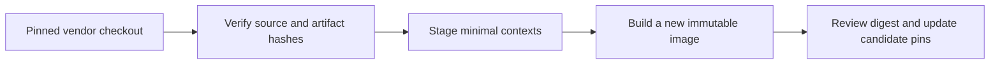

# Locked image build inputs



| Image family | Build source |
| --- | --- |
| Elasticsearch, Kafka helper, Elasticsearch/Kibana initialization, optional calibration helper | Five local Dockerfiles and locked scripts/artifacts in `derived-images.lock.json`; NVIDIA VSS commit `7640d917047cf7b0fd3085eefb8282754b56bc94`. The separate Logstash Dockerfile below makes six in total. |
| Logstash protobuf runtime | `Dockerfile.logstash-protobuf` plus the checksum-locked offline plug-in pack. |
| NvStreamer | [Dedicated source patches](../../patches/nvstreamer-sync/): patches 0001–0004 on development commit `ac7d872f1a5ba5e5641562c0aa9a4a37138da390`, including runtime media packages. |
| Warehouse UI | [UI patches](../../patches/ui-alert-rules/): pinned v3.2.1 checkout, patches 0001/0002 and locked package inputs. |
| Agent/MCP | Stock pinned Agent image plus the complete final ConfigMap overlays embedded in the baseline: report binding, exact-incident lookup and follow-up. The older two-patch Agent Dockerfile alone is not this final configuration. |

Source pins and recipes are preserved; a complete clean rebuild of all runtime
images is still an acceptance item in [validation scope](../../VALIDATION.md).
The [prebuilt-image restore path](../../images/README.md) uses the preserved
images and does not require a rebuild.
The primary vendor baseline is
[NVIDIA VSS v3.2.1](https://github.com/NVIDIA-AI-Blueprints/video-search-and-summarization/tree/v3.2.1).
Obtain clean source checkouts at the commits above, then run from
`warehouse-vss-demo/deployment/build`:

```bash
python3 scripts/fetch-derived-image-artifacts.py --output artifacts
bash scripts/build-derived-images.sh --source vendor/vss --artifacts artifacts \
  --repository-prefix registry.example.com/warehouse --version 3.2.1-candidate.1
# Add --execute only after reviewing the local build plan.
bash scripts/prepare-logstash-offline-pack.sh --output artifacts
bash scripts/build-logstash-derived-image.sh --artifacts artifacts \
  --repository-prefix registry.example.com/warehouse --version 3.2.1-candidate.1
```

Build NvStreamer and the UI with the source-verified helper below. Use clean
checkouts at the two commits in the table, with their Git LFS files available.
Set each `*_PIN` to the reviewed full `repository@sha256:digest` for that
upstream base image; the helper rejects tags as base-image replacements.

```bash
python3 scripts/build-nvstreamer-ui.py --component nvstreamer \
  --source vendor/nvstreamer --tag registry.example.com/warehouse/nvstreamer:dev-26.08.4-p4 \
  --base-image "nvcr.io/nvidia/cuda:13.2.0-devel-ubuntu24.04=${CUDA_DEVEL_PIN:?set reviewed pin}" \
  --base-image "nvcr.io/nvidia/cuda:13.2.0-runtime-ubuntu24.04=${CUDA_RUNTIME_PIN:?set reviewed pin}"
python3 scripts/build-nvstreamer-ui.py --component ui \
  --source vendor/vss --tag registry.example.com/warehouse/ui:3.2.1-p2 \
  --base-image "node:22.22.3=${NODE_PIN:?set reviewed pin}" \
  --base-image "nvcr.io/nvidia/distroless/node:22-v4.0.7=${UI_PROD_PIN:?set reviewed pin}" \
  --base-image "nvcr.io/nvidia/distroless/node:22-v4.0.7-dev=${UI_DEV_PIN:?set reviewed pin}"
```

These are plans. Add `--output NEW_DIRECTORY --prepare` to verify/apply
patches privately without building, or `--output NEW_DIRECTORY --execute`
to build locally. Input checkouts stay unchanged. NvStreamer selects patches
0001–0004 and the runtime-packages overlay; the UI selects both recorded
patches. NVIDIA's package installers still contact their repositories, so
base/source pins alone do not guarantee a bit-identical rebuild.

Build scripts do not log in, push images, edit workload manifests or contact
OpenShift. The Kafka helper's selected output is the corrected random-UID
replacement, not its superseded original digest.

The captured registry digests identify the preserved images. A new build can
produce a different manifest digest even from the same source. Review and
record that output explicitly; do not replace a pin silently. Mirror/import
the authorized preserved images when exact captured digests are required.
Use `site.images.reviewedImageOverrides` to map each captured full pin to
its reviewed rebuilt registry pin. Repository-only mirrors preserve the old
digest and apply only to exact copies. The supplied publisher verifies the
locked set rather than choosing a new unreviewed output. Registry credentials
and restricted model weights are obtained separately and never stored in
the source tree.
